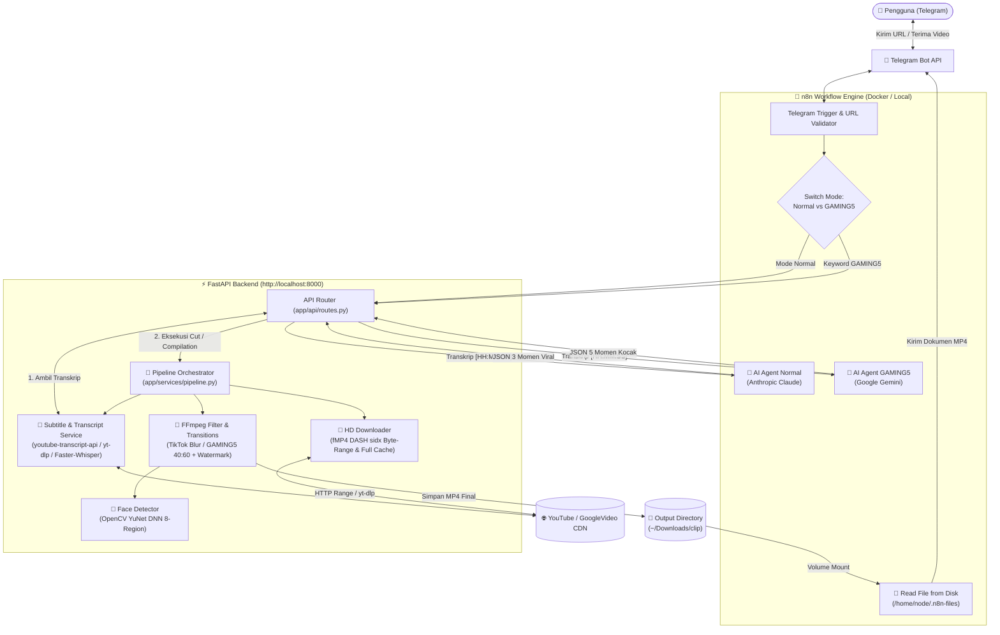

# Product Requirements Document (PRD) — Auto Clip Pop n8n 🎬

| Metadata Dokumen | Detail |
| :--- | :--- |
| **Nama Proyek** | Auto Clip Pop n8n (`bridge-clipping`) |
| **Kategori Sistem** | AI-Powered Short-Form Video Clipping & Workflow Automation |
| **Stack Utama** | Python (FastAPI), FFmpeg, yt-dlp, Faster-Whisper, OpenCV YuNet DNN, n8n, Telegram Bot, Claude & Gemini AI |
| **Port Default Backend** | `http://0.0.0.0:8000` |
| **Target Output** | Video Vertikal 9:16 (`1080×1920`, MP4 H.264/AAC) siap unggah ke TikTok, YouTube Shorts, & Instagram Reels |

---

## 1. Ringkasan Eksekutif & Gambaran Umum Proyek

### 1.1 Latar Belakang Masalah
Pembuatan konten video pendek (*short-form video* seperti TikTok, YouTube Shorts, dan Instagram Reels) dari video berdurasi panjang atau rekaman *live streaming* (VOD) membutuhkan waktu lama jika dilakukan secara manual:
1. Editor harus menonton berjam-jam video untuk mencari momen lucu, heboh, atau viral.
2. Mengunduh video berdurasi panjang (terutama rekaman *live stream* 2–5 jam) memakan kuota, waktu, dan ruang penyimpanan besar, serta sering terkendala pembatasan (*throttling* HTTP 403) dari CDN YouTube.
3. Mengubah rasio video dari *landscape* (16:9) menjadi *portrait* (9:16), memotong area *facecam* streamer secara pas, menambahkan *watermark*, menggabungkan klip dengan transisi, hingga membuat *subtitle* karaoke kata-per-kata (*word-by-word*) memerlukan proses *editing* berulang yang rumit.

### 1.2 Solusi yang Dihadirkan
**Auto Clip Pop n8n** adalah sistem otomatisasi *end-to-end* yang mengubah tautan video YouTube (baik video reguler, *short link*, maupun rekaman *live stream* dan konten *Members-Only*) menjadi klip video vertikal siap unggah hanya dengan mengirimkan satu pesan perintah melalui **Telegram Bot**.

Sistem ini menggabungkan dua komponen utama:
1. **Orkestrator Workflow & Kurasi AI (n8n)**: Menerima perintah dari Telegram Bot, meminta transkrip dari backend, menganalisis transkrip menggunakan LLM (**Anthropic Claude** untuk konten umum/podcast/vlog dan **Google Gemini** untuk komedi *gaming*), memilih momen terbaik beserta *hook* dan *caption*, lalu memerintahkan backend untuk memproses video dan mengirimkan hasilnya kembali ke pengguna di Telegram.
2. **Media Processing Engine (FastAPI Backend)**: Layanan berbasis Python yang menangani pengambilan transkrip (dengan *fallback* otomatis ke `yt-dlp`), pengunduhan potongan video kualitas HD secara cerdas (melalui *byte-range* fMP4 DASH atau *full-video caching*), pembuatan *subtitle* karaoke otomatis menggunakan **Faster-Whisper**, pendeteksian wajah *streamer* menggunakan **OpenCV YuNet DNN**, perakitan filter visual **FFmpeg**, penggabungan transisi, hingga kompresi ukuran file.

---

## 2. Fitur Utama & Kapabilitas Sistem

### 2.1 Ekstraksi Transkrip Multi-Jalur & Filter Rentang Waktu
- **Jalur Utama (`youtube-transcript-api`)**: Mengambil transkrip bahasa Indonesia (`id`) atau Inggris (`en`) secara cepat untuk video publik standar.
- **Jalur Fallback (`yt-dlp` Auto-Subs)**: Jika `youtube-transcript-api` gagal (misalnya pada video *Members-Only* atau format *caption* khusus), sistem otomatis beralih menggunakan `yt-dlp` dengan *client* `web_embedded` dan dukungan *cookies* (`youtube_cookies.txt`) untuk mengunduh file `.vtt`/`.srt` tanpa perlu mengunduh videonya (`--skip-download -f sb0`), dengan urutan prioritas bahasa: **Indonesia (`id`) > Original > Inggris (`en`)**.
- **Filter Rentang Waktu (`range`)**: Pengguna dapat menentukan rentang waktu spesifik (contoh: `00:05:00-00:30:00`) agar AI hanya menganalisis segmen tersebut. *Timestamp* yang dihasilkan tetap bersifat **absolut** terhadap durasi asli video sehingga dapat langsung dieksekusi oleh *endpoint* pemotongan.

### 2.2 Kurasi Momen Viral Berbasis AI (Dual AI Agent)
- **Mode Normal (3 Klip Terbaik — Claude AI)**:
  - Mencari **3 momen berdurasi 30–60 detik** dengan potensi viral tertinggi berdasarkan 5 kriteria prioritas: *Kocak/Lucu*, *Heboh*, *Senggol-menyenggol*, *Kontroversial*, dan *Romantis/Baper*.
  - Menghasilkan *timestamp* presisi, skor keviralan, kutipan alasan langsung dari transkrip, serta *caption* lengkap dengan kalimat *hook* dan minimal 5 *hashtag* relevan.
- **Mode Kompilasi Gaming (`GAMING5` — 5 Klip Komedi — Gemini AI)**:
  - Mencari **5 momen komedi *gaming* berdurasi 10–20 detik** yang memancing tawa dalam 1–3 detik pertama berdasarkan 4 kategori: *Reaksi Lebay*, *Reaksi Horor/Jumpscare*, *Reaksi Kocak/Blunder*, dan *Roasting/Bully*.
  - Hasil 5 klip diurutkan secara kronologis untuk digabungkan menjadi 1 video kompilasi *highlight*.

### 2.3 Engine Pengunduhan Video 2-Tier & Anti-Throttle (HTTP 403)
Karena YouTube telah menghapus format progresif HD (`itag 22`) dan *remote seek* FFmpeg pada stream DASH sering menggantung (*hang*) atau ditolak dengan HTTP 403, proyek ini mengimplementasikan arsitektur pengunduhan khusus:
1. **Tier 0 — Fast HD Section Downloader via fMP4 Byte-Range (`hd_downloader.py`)**:
   - Mengekstrak URL langsung `googlevideo.com` beserta `http_headers` autentiknya melalui kaskade *player client* (`web_embedded` + PO Token, `android_vr`, `tv`, `web`).
   - Mengunduh *header* awal file (`ftyp` + `moov` + `sidx`, sekitar 512KB–8MB) dan melakukan *binary parsing* pada kotak `sidx` (*Segment Index*) untuk memetakan waktu ke *byte offset* secara presisi.
   - Mengunduh **hanya fragmen byte (`moof` + `mdat`)** pada rentang waktu yang dibutuhkan untuk stream video HD (`720p60` / `720p30` / `1080p60` / `1080p30`) dan stream audio (`itag 140` atau multi-track `ba[ext=m4a]`).
   - Memotong video dan audio secara terpisah dengan *offset* fragmen masing-masing agar **sinkronisasi audio-video (A/V sync) 100% akurat**, lalu menggabungkannya.
   - Dilengkapi **Disk Cache URL Ungated (`hd_url_cache.json`)**, *per-worker thread cache*, *retry* otomatis pada URL yang sama saat terkena 403 transien, dan pembersihan otomatis *cache* `~/.cache/yt-dlp/youtube-sigfuncs` jika tantangan tanda tangan `n` kedaluwarsa.
2. **Tier 1 — Full Video Cache + Instant Local Cut (`pipeline.py`)**:
   - Jika Tier 0 terblokir oleh *jump-range gate* GVS (HTTP 403 menyeluruh), sistem otomatis melakukan *fallback* dengan mengunduh video penuh satu kali (`full_{video_id}.mp4`) menggunakan *client* `web_embedded` (prioritas **720p AVC merged**, *fallback* ke **360p progresif** jika 720p gagal).
   - Dilindungi oleh `threading.Lock()` global agar permintaan paralel tidak mengunduh video yang sama berulang kali.
   - Pemotongan segmen dilakukan secara lokal menggunakan `ffmpeg -c copy` yang selesai secara instan.
   - Dilengkapi **Auto Cache Cleanup** yang menghapus cache video berumur > 24 jam atau menjaga total ukuran cache di bawah 20 GB.

### 2.4 Deteksi Wajah Streamer Otomatis (OpenCV YuNet DNN)
- Menggunakan model CNN ringan **YuNet (`face_detection_yunet_2023mar.onnx`)** yang terintegrasi dengan OpenCV.
- Mengekstrak **5 *sample frame*** secara merata dari potongan video dan memindai **8 area *facecam*** (4 pojok: `topleft`, `topright`, `btmleft`, `btmright` + 4 tepi tengah: `leftmid`, `rightmid`, `topmid`, `btmmid`), di mana masing-masing area berukuran 22% lebar × 30% tinggi frame (diperluas `1.6×` per dimensi pada mode `GAMING5`).
- Melakukan *upscaling* Lanczos otomatis jika potongan gambar terlalu kecil (<150px) dan menerapkan **Majority Voting** (wajah harus terdeteksi di minimal 2 dari 5 frame) untuk menghindari *false positive* dari karakter di dalam *game*.
- Jika tidak ada wajah yang lolos *voting*, sistem otomatis melakukan *fallback* ke posisi manual (`facecam_position`) yang dipilih pengguna.

### 2.5 Auto Subtitle Karaoke Word-by-Word (Faster-Whisper + ASS)
- Menggunakan **Faster-Whisper** model `small` pada CPU dengan komputasi `int8` dan *Voice Activity Detection* (`vad_filter=True`, `min_silence_duration_ms=500`).
- Menghasilkan *word-level timestamps* bahasa Indonesia dan mengonversinya menjadi format subtitle **Advanced SubStation Alpha (`.ass`)**.
- Menampilkan animasi teks terakumulasi maksimal 2 kata per baris (atau ganti baris jika jeda > 0,7 detik) menggunakan font **Google Sans (56pt, Bold)** berwarna putih dengan efek sorotan karaoke (`\K` tag) berwarna kuning pada kata yang sedang diucapkan.

### 2.6 Pemrosesan Layout Visual & Kompilasi (FFmpeg Filter Chains)
- **Mode Normal (`normal`)**:
  - Kanvas vertikal `1080×1920`.
  - *Background*: Video asli diperbesar memenuhi `1080×1920` dengan efek `boxblur=15:15`.
  - *Foreground*: Video tengah berukuran persegi `1080×1080` dengan *light denoise* (`hqdn3d=2:1:3:2`), *upscaling* `lanczos+accurate_rnd`, penajaman gambar (`unsharp` + *Contrast Adaptive Sharpening* `cas=0.3`), dan *subtitle* karaoke `.ass` yang dibakar (*burn-in*) langsung ke dalam video.
- **Mode Gaming (`GAMING5`)**:
  - Kanvas vertikal `1080×1920` dengan tata letak tumpuk vertikal (**40% Atas : 60% Bawah**):
    - **40% Atas (`1080×768`) — Facecam**: Hasil *crop* wajah *streamer* berasio `1080:768` (1.40625), diproses dengan *light denoise* (`hqdn3d=1:1:2:1`), *scale* `lanczos`, dan penajaman pasca-skala (`unsharp=7:7:1.2:7:7:0.5` + `cas=0.7`) agar *facecam* tetap tajam dan tidak pecah/buram.
    - **60% Bawah (`1080×1152`) — Gameplay**: Visual permainan diperbesar dan dipotong tepat di tengah memenuhi area `1080×1152`.
    - **Watermark Overlay**: Jika `assets/images/watermark.png` tersedia, *watermark* diskalakan ke lebar `150px` dan ditempatkan tepat di tengah layar `(W-w)/2:(H-h)/2`.
    - **Tanpa Subtitle**: Whisper dilewati pada mode `GAMING5` untuk mempercepat pemrosesan dan menjaga area visual *gameplay* tetap bersih.
    - **5 Video Terpisah (Tanpa Concat/Transisi)**: Kelima klip yang telah difilter secara paralel (3 *worker* dengan pembatasan `ENCODE_THREADS` agar CPU tidak *thrashing*) disimpan sebagai 5 file `.mp4` terpisah (`final_gaming_<start>_<idx>.mp4`) untuk dikirim satu per satu secara bertahap via Telegram.

### 2.7 Kompresi Otomatis & Pemeriksaan Sesi Cookies
- **Auto-Compress (<45 MB)**: Jika hasil akhir klip melebihi batas target (default `45 MB`, aman untuk batas pengiriman Telegram Bot / WhatsApp), sistem menghitung ulang *target bitrate* video berdasarkan durasi dan melakukan *re-encode* otomatis.
- **Cookie Fail-Fast (`check_session_ok`)**: Sebelum memulai proses berat, sistem memeriksa apakah URL yang dikirim adalah video *Members-Only*. Jika *cookies* tidak ada, sudah kedaluwarsa/dirotasi, atau akun tidak memiliki akses *membership*, proses langsung dihentikan di awal dengan pesan kesalahan yang jelas.

---

## 3. Arsitektur Sistem & Alur Kerja

### 3.1 Diagram Arsitektur Komponen



### 3.2 Alur Kerja Mode Normal (Default — 3 Klip)
1. Pengguna mengirim pesan ke Telegram Bot: `<URL_YouTube> [opsional: HH:MM:SS-HH:MM:SS]`.
2. **n8n** memvalidasi bahwa pesan berisi `youtube.com` atau `youtu.be` dan bukan mode `GAMING` lama (yang sudah dihapus) maupun `GAMING5`.
3. **n8n** memanggil `GET /transcript?url=...&range=...` ke backend FastAPI.
4. Backend mengambil transkrip via `youtube-transcript-api` (atau *fallback* ke `yt-dlp --write-auto-subs`) dan mengembalikan teks berformat `[HH:MM:SS] teks`.
5. **AI Agent (Claude)** menganalisis transkrip dan memilih **3 momen viral terbaik** (durasi 30–60 detik) dalam format JSON.
6. **n8n** mengirim notifikasi daftar 3 momen yang ditemukan ke Telegram pengguna, lalu memanggil `POST /cut-batch` ke backend.
7. Untuk setiap klip secara berurutan (*sequential*):
   - Backend memeriksa validitas sesi *cookies* (`check_session_ok`).
   - Mengunduh segmen video (Tier 0 HD *byte-range* → *fallback* Tier 1 *full download* + potong lokal).
   - Mengekstrak audio `.wav` 16kHz mono dan menjalankan **Faster-Whisper** untuk menghasilkan file subtitle `.ass` karaoke *word-by-word*.
   - Menjalankan `apply_tiktok_filter` (*background blur* `1080×1920` + *foreground* `1080×1080` + *subtitle burn-in*).
   - Mengompresi video jika ukurannya > 45 MB dan menyimpannya ke `OUTPUT_DIR` (`final_tiktok_<start>_<idx>.mp4`).
8. **n8n** membaca ketiga file video dari disk dan mengirimkannya satu per satu ke Telegram pengguna beserta ringkasan akhir.

### 3.3 Alur Kerja Mode Gaming (`GAMING5` — 5 Klip Terpisah)
1. Pengguna mengirim pesan ke Telegram Bot: `<URL_YouTube> [opsional: HH:MM:SS-HH:MM:SS] GAMING5 [opsional: posisi_facecam]`.
2. **n8n** mendeteksi kata kunci `GAMING5`, mengambil transkrip dari `GET /transcript`, dan meneruskannya ke **AI Agent GAMING5 (Google Gemini)**.
3. **AI Agent GAMING5** memilih **5 momen komedi *gaming* terbaik** (durasi 10–20 detik, terurut kronologis).
4. **n8n** mengekstrak parameter posisi *facecam* manual (jika disertakan, default `btmleft`), mengirim daftar 5 momen ke Telegram pengguna, dan memanggil `POST /cut-gaming-compilation`.
5. Backend menjalankan pipeline `process_gaming_compilation`:
   - Membersihkan *cache* video penuh yang sudah kedaluwarsa (`cleanup_full_video_cache`).
   - **Step 1 (Sequential Anti-Burst Download)**: Mengunduh ke-5 potongan klip satu per satu untuk menghindari *rate-limit* HTTP 403 dari CDN YouTube.
   - **Step 1b (Retry Pass)**: Jika ada klip yang gagal diunduh pada Step 1, dilakukan *retry pass* serial hingga 2 kali dengan jeda *cooldown* 10 detik.
   - **Step 2 (Whisper Skip)**: Pembuatan subtitle dilewati untuk mode *gaming*.
   - **Step 3 (Parallel Gaming Filter — 3 Workers)**: Memproses maksimal 3 klip sekaligus. Pada tiap klip, **YuNet DNN** mendeteksi koordinat wajah *streamer* di 8 region, lalu FFmpeg menyusun layout **40% Facecam (`1080×768`) di atas + 60% Gameplay (`1080×1152`) di bawah + Watermark (`150px`) di tengah**.
   - **Step 4 (Save & Compress Individual Clips)**: Menyimpan dan mengompresi masing-masing dari 5 klip secara terpisah ke `OUTPUT_DIR` (`final_gaming_<start>_<idx>.mp4`) tanpa digabung dan tanpa transisi.
6. **n8n** memecah *array* 5 klip (`Split G5 Result`), membaca tiap file dari disk (`Read G5 File`), dan mengirimkannya satu per satu secara bertahap ke Telegram pengguna (`Send a document1`).

---

## 4. Struktur Direktori & Modul Proyek

```text
auto-clip-pop-n8n-main/
├── run.py                                            # Entry point server FastAPI (uvicorn port 8000)
├── requirements.txt                                  # Daftar paket dependensi Python
├── youtube_cookies.txt                               # File cookies YouTube format Netscape (opsional/members-only)
├── README.md                                         # Dokumentasi ringkas proyek
├── PRD.md                                            # Dokumen Product Requirements Document ini
├── app/
│   ├── __init__.py
│   ├── main.py                                       # Inisialisasi aplikasi FastAPI & registrasi router
│   ├── config.py                                     # Konfigurasi path, konstanta cache, lazy-load Whisper, auto-discovery ffmpeg/yt-dlp
│   ├── api/
│   │   ├── __init__.py
│   │   └── routes.py                                 # Handler endpoint API (/transcript, /cut, /cut-batch, /cut-gaming-compilation)
│   ├── models/
│   │   ├── __init__.py
│   │   └── requests.py                               # Skema validasi request Pydantic (ClipRequest, BatchClipRequest, GamingCompilationRequest)
│   ├── services/
│   │   ├── __init__.py
│   │   ├── pipeline.py                               # Orkestrasi utama: download, cache cleanup, single/batch clip, gaming compilation
│   │   ├── hd_downloader.py                          # Pengunduh segmen HD via fMP4 DASH sidx byte-range, URL/media cache, & cookie health check
│   │   ├── face_detector.py                          # Deteksi wajah otomatis dengan OpenCV YuNet DNN di 8 region + majority voting
│   │   ├── filters.py                                # Filter FFmpeg untuk layout TikTok Normal & Gaming Compilation (GAMING5)
│   │   ├── subtitles.py                              # Transkripsi Faster-Whisper, generator subtitle SRT/ASS karaoke, & fallback yt-dlp subs
│   │   └── transitions.py                            # Generator transisi layar hitam + suara, penggabungan (concat), & kompresi ukuran file
│   └── utils/
│       ├── __init__.py
│       └── helpers.py                                # Fungsi utilitas konversi waktu (HH:MM:SS <-> detik), ekstraksi video ID, & parser rentang waktu
├── assets/
│   ├── images/
│   │   └── watermark.png                             # Gambar watermark (ditempel ukuran 150px di tengah pada mode GAMING5)
│   ├── models/
│   │   └── face_detection_yunet_2023mar.onnx         # Model DNN OpenCV YuNet (~232 KB, auto-download jika belum ada)
│   └── sounds/
│       └── transisi_sound.mpeg                       # Efek suara transisi antar klip pada kompilasi gaming
└── n8n/
    └── workflow.json                                 # File definisi workflow n8n siap impor (Telegram + Claude + Gemini + HTTP Requests)
```

---

## 5. Spesifikasi Teknis & API Reference

Backend FastAPI berjalan secara default di `http://0.0.0.0:8000` dan menyediakan dokumentasi interaktif Swagger UI di `http://localhost:8000/docs`.

### 5.1 `GET /transcript`
Mengambil transkrip teks dari video YouTube beserta *timestamp* dalam format `[HH:MM:SS]`.

- **Query Parameters**:
  | Parameter | Tipe | Wajib | Default | Deskripsi |
  | :--- | :--- | :---: | :---: | :--- |
  | `url` | `string` | Ya | — | Tautan video YouTube (`youtube.com/watch?v=...`, `youtu.be/...`, atau `youtube.com/live/...`). |
  | `range` | `string` | Tidak | `""` | Filter rentang waktu berformat `HH:MM:SS-HH:MM:SS` (atau `MM:SS-MM:SS`). Hanya baris yang masuk dalam rentang ini yang dikembalikan. |

- **Contoh Request**:
  ```bash
  curl "http://localhost:8000/transcript?url=https://www.youtube.com/watch?v=dQw4w9WgXcQ&range=00:01:00-00:05:00"
  ```
- **Contoh Response Sukses (`200 OK`)**:
  ```json
  {
    "transcript": "[00:01:02] Halo semuanya selamat datang kembali\n[00:01:06] Hari ini kita akan mencoba game baru..."
  }
  ```
- **Contoh Response Gagal**:
  ```json
  {
    "error": "Gagal ambil transkrip (youtube-transcript-api & yt-dlp subs)"
  }
  ```

---

### 5.2 `POST /cut`
Memotong **1 klip tunggal** dalam mode normal (layout TikTok + *auto subtitle* Whisper).

- **Request Body (`application/json`)**:
  ```json
  {
    "url": "https://www.youtube.com/watch?v=xxxxx",
    "start": "00:01:30",
    "end": "00:02:15",
    "mode": "normal"
  }
  ```
  > **Catatan Penting**: Nilai `mode` hanya mendukung `"normal"`. Mode `"gaming"` tunggal lama telah dihapus; untuk konten *gaming*, gunakan *endpoint* `/cut-gaming-compilation`.

- **Contoh Response Sukses**:
  ```json
  {
    "file": "final_tiktok_000130_0.mp4",
    "size_mb": 12.4,
    "mode": "normal",
    "status": "success"
  }
  ```

---

### 5.3 `POST /cut-batch`
Memotong **banyak klip sekaligus** dari satu URL video YouTube dalam mode normal. Digunakan oleh workflow n8n untuk memproses 3 momen pilihan AI dalam satu panggilan HTTP dengan isolasi *error* per klip.

- **Request Body (`application/json`)**:
  ```json
  {
    "url": "https://www.youtube.com/watch?v=xxxxx",
    "clips": [
      {"start": "00:01:30", "end": "00:02:15"},
      {"start": "00:10:05", "end": "00:10:50"},
      {"start": "00:24:10", "end": "00:24:55"}
    ],
    "mode": "normal"
  }
  ```
- **Contoh Response Sukses**:
  ```json
  {
    "status": "done",
    "total": 3,
    "success": 3,
    "failed": 0,
    "clips": [
      {"file": "final_tiktok_000130_0.mp4", "size_mb": 11.2, "mode": "normal", "status": "success"},
      {"file": "final_tiktok_001005_1.mp4", "size_mb": 14.8, "mode": "normal", "status": "success"},
      {"file": "final_tiktok_002410_2.mp4", "size_mb": 9.6, "mode": "normal", "status": "success"}
    ]
  }
  ```

---

### 5.4 `POST /cut-gaming-compilation`
Memotong *N* klip (standar 5 klip untuk `GAMING5`), menerapkan *auto facecam detection* YuNet + layout 40% atas (*facecam*) / 60% bawah (*gameplay*) + *watermark* tengah, lalu menyimpan masing-masing klip secara **terpisah** (tanpa digabung dan tanpa transisi).

- **Request Body (`application/json`)**:
  ```json
  {
    "url": "https://www.youtube.com/watch?v=xxxxx",
    "clips": [
      {"start": "00:04:12", "end": "00:04:28"},
      {"start": "00:15:30", "end": "00:15:48"},
      {"start": "00:32:10", "end": "00:32:25"},
      {"start": "00:48:00", "end": "00:48:18"},
      {"start": "01:05:22", "end": "01:05:40"}
    ],
    "facecam_position": "btmleft"
  }
  ```
- **Opsi `facecam_position` (Fallback jika YuNet tidak mendeteksi wajah)**:
  | Nilai | Posisi Area Facecam |
  | :--- | :--- |
  | `btmleft` *(default)* | Pojok Kiri Bawah |
  | `btmright` | Pojok Kanan Bawah |
  | `topleft` | Pojok Kiri Atas |
  | `topright` | Pojok Kanan Atas |
  | `leftmid` | Tepi Kiri Tengah |
  | `rightmid` | Tepi Kanan Tengah |
  | `topmid` | Tepi Atas Tengah |
  | `btmmid` | Tepi Bawah Tengah |

- **Contoh Response Sukses**:
  ```json
  {
    "status": "done",
    "total": 5,
    "success": 5,
    "failed": 0,
    "facecam_position": "btmleft",
    "clips": [
      {"file": "final_gaming_000412_0.mp4", "size_mb": 6.4, "status": "success"},
      {"file": "final_gaming_001530_1.mp4", "size_mb": 7.1, "status": "success"},
      {"file": "final_gaming_003210_2.mp4", "size_mb": 5.9, "status": "success"},
      {"file": "final_gaming_004800_3.mp4", "size_mb": 6.8, "status": "success"},
      {"file": "final_gaming_010522_4.mp4", "size_mb": 7.2, "status": "success"}
    ]
  }
  ```

---

## 6. Kebutuhan Sistem (Requirements & Prerequisites)

### 6.1 Spesifikasi Perangkat Keras (Hardware Requirements)
| Komponen | Minimum | Rekomendasi | Catatan |
| :--- | :--- | :--- | :--- |
| **CPU** | 4 Cores / 4 Threads | 6+ Cores / 12+ Threads | Sangat berpengaruh pada kecepatan *encoding* `libx264` paralel (3 *worker*) dan inferensi CPU `faster-whisper`. |
| **RAM** | 8 GB | 16 GB+ | Dibutuhkan oleh model Whisper `small`, buffer FFmpeg paralel, dan container Docker n8n. |
| **Penyimpanan (Disk)** | 15 GB ruang kosong | 35 GB+ ruang kosong (SSD) | Folder `TMP_DIR` menyimpan *cache* video penuh (`full_{id}.mp4`) dengan batas kuota otomatis maksimal `20 GB`. |
| **Koneksi Internet** | 20 Mbps stabil | 50+ Mbps | Mengunduh stream video HD dari CDN YouTube dan mengirim file video ke API Telegram. |

### 6.2 Perangkat Lunak & Runtime Sistem (System Dependencies)
1. **Sistem Operasi**: Windows 10/11 (64-bit), Linux, atau macOS. *(Proyek memiliki dukungan *auto-discovery* khusus untuk path instalasi WinGet/Program Files di Windows)*.
2. **Python**: Versi **3.11 atau lebih baru** (menggunakan tipe anotasi `str | None` dan `list[dict]`).
3. **FFmpeg & FFprobe**: Wajib terinstal di sistem.
   - Di Windows, `app/config.py` otomatis mencari di `PATH`, paket WinGet (`Gyan.FFmpeg_*`), `C:\Program Files\FFmpeg\bin`, dan `C:\ffmpeg\bin`.
4. **yt-dlp**: Wajib terinstal (baik di dalam `Scripts` virtual environment Python maupun di `PATH` sistem) dan disarankan selalu diperbarui ke versi terbaru (`pip install -U yt-dlp`).
5. **Node.js (v18+)**: **Wajib** terinstal di `PATH` karena `yt-dlp` dijalankan dengan flag `--js-runtimes node --remote-components ejs:github` untuk memecahkan *signature challenge* (`n`-challenge) YouTube.
6. **Font Sistem (Opsional/Disarankan)**: Font **Google Sans** terinstal di OS agar *rendering* subtitle `.ass` oleh FFmpeg (`libass`) tampil sesuai desain. Jika tidak ada, `libass` akan menggunakan font *fallback* sistem (seperti Arial/ Sans-Serif).
7. **n8n**: Dapat dijalankan melalui **Docker Desktop** atau `npx n8n` / instalasi global npm.
8. **PO Token Provider (Opsional untuk Live VOD HD)**: Jika ingin menembus *gate jump-range* GVS pada rekaman *live stream* dengan tingkat keberhasilan lebih tinggi pada `yt-dlp`, plugin `bgutil-ytdlp-pot-provider` (berjalan di port `:4416`) dapat digunakan bersama *flag* `fetch_pot=always` yang sudah terkonfigurasi di `hd_downloader.py`.

### 6.3 Dependensi Library Python (`requirements.txt`)
| Paket Python | Versi | Kegunaan dalam Proyek |
| :--- | :--- | :--- |
| `fastapi` | `>=0.100.0` | Framework web REST API untuk backend pemrosesan video. |
| `uvicorn` | `>=0.22.0` | Server ASGI untuk menjalankan aplikasi FastAPI. |
| `youtube-transcript-api` | `>=0.6.0` | Mengambil transkrip/subtitle YouTube secara langsung tanpa mengunduh video. |
| `faster-whisper` | `>=1.0.0` | Engine Speech-to-Text berbasis CTranslate2 (model `small` int8) untuk *word-level timestamps* karaoke. |
| `pydantic` | `>=2.0.0` | Validasi skema payload request JSON pada endpoint FastAPI. |
| `opencv-python` | `>=4.8.0` | Memuat gambar sample frame dan menjalankan detektor wajah `cv2.FaceDetectorYN` (YuNet). |
| `numpy` | `>=1.24.0` | Operasi matriks gambar untuk pemotongan region *facecam* OpenCV. |

### 6.4 Kredensial & Layanan Eksternal (untuk n8n Workflow)
- **Telegram Bot Token**: Dibuat melalui `@BotFather` di Telegram.
- **Anthropic API Key**: Untuk node `Anthropic Chat Model` (Claude) pada analisis Mode Normal.
- **Google Gemini (PaLM) API Key**: Untuk node `Google Gemini Chat Model1` pada analisis Mode `GAMING5`.

---

## 7. Konfigurasi Sistem

Seluruh konstanta utama terpusat di [config.py](file:///C:/Project/auto-clip-pop-n8n-main/app/config.py) dan dapat disesuaikan dengan kebutuhan lingkungan server:

| Konstanta | Lokasi File | Nilai Default | Penjelasan |
| :--- | :--- | :--- | :--- |
| `OUTPUT_DIR` | `app/config.py` | `~/Downloads/clip` | Direktori penyimpanan hasil video akhir (`final_tiktok_*.mp4` & `gaming_compilation_*.mp4`). Dibuat otomatis jika belum ada. |
| `TMP_DIR` | `app/config.py` | `tempfile.gettempdir()` | Direktori file sementara (potongan mentah, audio `.wav`, subtitle `.ass`, cache `full_{id}.mp4`, dan `hd_url_cache.json`). |
| `COOKIES_PATH` | `app/config.py` | `./youtube_cookies.txt` | Lokasi file cookies YouTube di root proyek. Otomatis dipakai oleh `yt-dlp` jika file tersebut ada. |
| `WATERMARK_PATH` | `app/config.py` | `assets/images/watermark.png` | Gambar watermark yang ditempelkan di tengah video pada mode `GAMING5`. |
| `TRANSISI_SOUND` | `app/config.py` | `assets/sounds/transisi_sound.mpeg` | Audio efek suara untuk layar hitam transisi antar klip pada kompilasi gaming. |
| `FULL_CACHE_MAX_AGE_HOURS` | `app/config.py` | `24` | Batas usia maksimal (jam) file cache `full_{id}.mp4` sebelum dihapus otomatis. |
| `FULL_CACHE_MAX_TOTAL_GB` | `app/config.py` | `20.0` | Batas kuota total ukuran cache video penuh di `TMP_DIR` (dalam Gigabyte). |
| `FACECAM_OUTPUT_SIZE` | `app/config.py` | `200` | Ukuran dasar *crop* persegi *facecam* (piksel) bila rasio target tidak ditentukan. |
| `FACE_DETECTION_CONFIDENCE` | `app/config.py` | `0.5` | Ambang batas skor *confidence* deteksi wajah YuNet (rentang `0.0`–`1.0`). |
| `FACE_DETECTION_SAMPLES` | `app/config.py` | `5` | Jumlah *sample frame* yang diekstrak per klip untuk *majority voting* deteksi wajah. |
| `ENCODE_THREADS` | `app/services/filters.py` | `max(2, cpu_count // 3)` | Jumlah *thread* FFmpeg per *worker* saat *encoding* paralel 3 klip `GAMING5` agar CPU tidak mengalami *oversubscription*. |
| `RETRY_PASS_ATTEMPTS` | `app/services/pipeline.py` | `2` | Jumlah percobaan ulang serial jika pengunduhan klip pada `GAMING5` gagal di tahap pertama. |

---

## 8. Panduan Instalasi & Cara Menjalankan

Ikuti langkah-langkah berikut secara berurutan untuk menjalankan keseluruhan sistem dari awal hingga siap digunakan.

### Langkah 1: Instalasi Prerequisites Sistem (Windows)
Pastikan **Python 3.11+**, **Node.js**, dan **FFmpeg** sudah terpasang di sistem Anda. Menggunakan PowerShell:

```powershell
# 1. Instal FFmpeg (melalui WinGet)
winget install Gyan.FFmpeg

# 2. Instal Node.js LTS (dibutuhkan oleh yt-dlp untuk JS challenge solver)
winget install OpenJS.NodeJS.LTS

# 3. Verifikasi instalasi di terminal baru
python --version
node --version
ffmpeg -version
ffprobe -version
```

### Langkah 2: Setup Virtual Environment & Dependensi Python
Buka terminal PowerShell di direktori proyek `C:\Project\auto-clip-pop-n8n-main`:

```powershell
# 1. Buat virtual environment (opsional namun sangat disarankan)
python -m venv .venv

# 2. Aktifkan virtual environment
.\.venv\Scripts\Activate.ps1

# 3. Upgrade pip dan instal seluruh dependensi Python + yt-dlp terbaru
python -m pip install --upgrade pip
pip install -r requirements.txt
pip install -U yt-dlp
```

> **Catatan Model AI Otomatis**:
> - Model deteksi wajah **YuNet (`face_detection_yunet_2023mar.onnx`)** sudah tersedia di `assets/models/` (atau akan diunduh otomatis ~232 KB dari OpenCV Zoo jika terhapus).
> - Model transkripsi **Faster-Whisper (`small`)** (~480 MB) akan diunduh secara otomatis ke cache HuggingFace saat pemanggilan pertama kali.

### Langkah 3: Konfigurasi Cookies YouTube (Opsional / Wajib untuk Konten Members-Only)
Untuk mengunduh video publik biasa, sistem dapat berjalan tanpa *cookies*. Namun, jika Anda ingin memotong video **Members-Only** atau menghindari blokir bot pada IP tertentu:
1. Buka browser Google Chrome dan login ke akun YouTube yang memiliki akses *Membership* aktif pada channel tujuan.
2. Pasang ekstensi Chrome **"Get cookies.txt LOCALLY"**.
3. Buka halaman `youtube.com`, ekspor *cookies* dalam format **Netscape**, lalu simpan/timpa ke file:
   `C:\Project\auto-clip-pop-n8n-main\youtube_cookies.txt`

### Langkah 4: Menjalankan Backend Server FastAPI
Jalankan server menggunakan file *entry point* [run.py](file:///C:/Project/auto-clip-pop-n8n-main/run.py):

```powershell
python run.py
```

Jika berhasil, terminal akan menampilkan:
```text
INFO:     Started server process [xxxx]
INFO:     Waiting for application startup.
INFO:     Application startup complete.
INFO:     Uvicorn running on http://0.0.0.0:8000 (Press CTRL+C to quit)
```
Buka `http://localhost:8000/docs` di browser untuk memastikan Swagger UI tampil dan semua endpoint terdaftar.

### Langkah 5: Menjalankan & Mengonfigurasi n8n (Orkestrator Workflow)

#### A. Menjalankan n8n dengan Docker (Disarankan)
Agar node **Read/Write Files from Disk** di n8n dapat membaca file video yang dihasilkan oleh FastAPI di folder `OUTPUT_DIR` (`C:\Users\<User>\Downloads\clip`), Anda **wajib melakukan *volume mounting*** folder tersebut ke `/home/node/.n8n-files` di dalam container Docker n8n:

```powershell
docker run -it --rm `
  --name n8n `
  -p 5678:5678 `
  -v n8n_data:/home/node/.n8n `
  -v "$HOME\Downloads\clip:/home/node/.n8n-files" `
  --add-host=host.docker.internal:host-gateway `
  n8nio/n8n
```

#### B. Mengimpor Workflow & Mengatur Kredensial di n8n
1. Buka dashboard n8n di browser: `http://localhost:5678`.
2. Buat workflow baru → klik menu titik tiga di kanan atas → pilih **Import from File...** → pilih file [n8n/workflow.json](file:///C:/Project/auto-clip-pop-n8n-main/n8n/workflow.json).
3. Konfigurasikan 3 kredensial pada node yang sesuai:
   - **Telegram account**: Masukkan *Bot Token* dari `@BotFather` pada node `Telegram Trigger` dan seluruh node pengiriman pesan/dokumen Telegram.
   - **Anthropic account**: Masukkan *API Key* Anthropic pada node `Anthropic Chat Model` (digunakan oleh `AI Agent` mode normal).
   - **Google Gemini(PaLM) Api account**: Masukkan *API Key* Google AI Studio pada node `Google Gemini Chat Model1` (digunakan oleh `AI Agent GAMING5`).
4. *(Jika n8n TIDAK dijalankan di Docker melainkan langsung di host lokal)*: Ubah URL pada node `HTTP Request`, `HTTP Request1`, `HTTP G5 Transcript`, dan `HTTP G5 Cut` dari `http://host.docker.internal:8000/...` menjadi `http://localhost:8000/...`, serta sesuaikan *path* di node `Read/Write Files from Disk` dan `Read G5 File` ke path lokal folder `Downloads/clip`.
5. Klik tombol **Active** (toggle di kanan atas) untuk mengaktifkan *webhook* Telegram Trigger.

---

### Langkah 6: Cara Menggunakan Sistem

#### Opsi A: Penggunaan via Telegram Bot (End-to-End)
Cukup kirimkan pesan ke Bot Telegram Anda dengan format berikut:

```text
<URL_YouTube> [opsional: HH:MM:SS-HH:MM:SS] [opsional: GAMING5] [opsional: posisi_facecam]
```

| Skenario Penggunaan | Contoh Pesan ke Telegram Bot | Hasil yang Diterima |
| :--- | :--- | :--- |
| **Mode Normal (Full Video)** | `https://www.youtube.com/watch?v=xxxxx` | AI memilih **3 momen viral (30–60d)** → dikirim sebagai **3 video terpisah** lengkap dengan *blur background* & *subtitle* karaoke Whisper. |
| **Mode Normal (Rentang Waktu)** | `https://www.youtube.com/watch?v=xxxxx 00:15:00-00:45:00` | Sama seperti Mode Normal, tetapi AI hanya mencari momen di antara menit ke-15 hingga menit ke-45. |
| **Mode Kompilasi Gaming (Auto Facecam)** | `https://www.youtube.com/watch?v=xxxxx GAMING5` | AI memilih **5 momen komedi (10–20d)** → YuNet mendeteksi posisi *facecam* otomatis → digabung menjadi **1 video kompilasi** dengan layout 40:60, *watermark*, dan transisi suara. |
| **Mode Kompilasi Gaming (Rentang + Posisi Fallback Manual)** | `https://www.youtube.com/live/xxxxx 01:00:00-02:00:00 GAMING5 btmright` | Kompilasi gaming dari jam ke-1 hingga jam ke-2; jika wajah tidak terdeteksi otomatis oleh YuNet, *crop facecam* diarahkan ke pojok kanan bawah (`btmright`). |

#### Opsi B: Pengujian Langsung ke Backend API (Tanpa n8n / Telegram)
Anda dapat menguji dan memakai *engine* pemotong video secara mandiri melalui PowerShell atau `curl`:

1. **Uji Ambil Transkrip**:
   ```powershell
   Invoke-RestMethod -Uri "http://localhost:8000/transcript?url=https://www.youtube.com/watch?v=dQw4w9WgXcQ&range=00:00:00-00:02:00" -Method Get
   ```

2. **Uji Potong 1 Klip Mode Normal (TikTok Layout + Auto Subtitle)**:
   ```powershell
   Invoke-RestMethod -Uri "http://localhost:8000/cut" -Method Post -ContentType "application/json" -Body '{
     "url": "https://www.youtube.com/watch?v=dQw4w9WgXcQ",
     "start": "00:00:15",
     "end": "00:00:45",
     "mode": "normal"
   }'
   ```

3. **Uji Kompilasi Gaming (`GAMING5`)**:
   ```powershell
   Invoke-RestMethod -Uri "http://localhost:8000/cut-gaming-compilation" -Method Post -ContentType "application/json" -Body '{
     "url": "https://www.youtube.com/watch?v=dQw4w9WgXcQ",
     "clips": [
       {"start": "00:00:10", "end": "00:00:25"},
       {"start": "00:00:40", "end": "00:00:55"}
     ],
     "facecam_position": "btmleft"
   }'
   ```
   Setelah proses selesai, periksa hasil video di folder `C:\Users\<UsernameAnda>\Downloads\clip\`.

---

## 9. Troubleshooting & Penanganan Masalah Umum

| Gejala / Pesan Error | Penyebab | Solusi |
| :--- | :--- | :--- |
| **`🍪 Cookies YouTube invalid/dirotasi` atau `🔒 Video members-only...`** | Sesi login di `youtube_cookies.txt` sudah kedaluwarsa, dirotasi oleh YouTube saat membuka tab baru di browser, atau akun belum bergabung (*Join*) ke *channel* tersebut. | Buka jendela *Incognito* baru di Chrome, login ke akun member, ekspor *cookies* dari `youtube.com/robots.txt` menggunakan ekstensi *Get cookies.txt LOCALLY*, tutup jendela *Incognito* agar sesi tidak berputar lagi, lalu timpa `youtube_cookies.txt`. |
| **`⚠️ HD byte-range gagal (403)... fallback full download`** | CDN GoogleVideo (GVS) mengaktifkan *jump-range gate* pada video/IP tersebut. | **Tidak perlu tindakan manual.** Sistem secara otomatis beralih ke Tier 1 (mengunduh video penuh sekali ke cache `TMP_DIR` via `web_embedded` lalu memotongnya secara lokal). Pastikan ruang disk kosong mencukupi (minimal 5–10 GB). |
| **`Gagal ambil transkrip (youtube-transcript-api & yt-dlp subs)`** | Video tidak memiliki *closed captions* (baik manual maupun *auto-generated* dari YouTube), atau *stream live* baru saja selesai sehingga YouTube belum selesai memproses *auto-caption*. | Pastikan tombol **CC** sudah tersedia saat video dibuka di YouTube, dan pastikan `node` serta `yt-dlp` sudah versi paling mutakhir (`pip install -U yt-dlp`). |
| **n8n gagal membaca file video (`ENOENT: no such file or directory, open '/home/node/.n8n-files/...'`)** | Folder `OUTPUT_DIR` di host Windows belum di-*mount* ke container Docker n8n. | Pastikan container Docker n8n dijalankan dengan flag `-v "$HOME\Downloads\clip:/home/node/.n8n-files"`. |
| **Pesan di Telegram dibalas: `Mode GAMING sudah dihapus`** | Pengguna mengetik kata kunci `GAMING` lama (tanpa angka `5`). | Gunakan kata kunci `GAMING5` untuk kompilasi gaming, atau kirim URL tanpa kata kunci `GAMING` untuk mode normal. |
